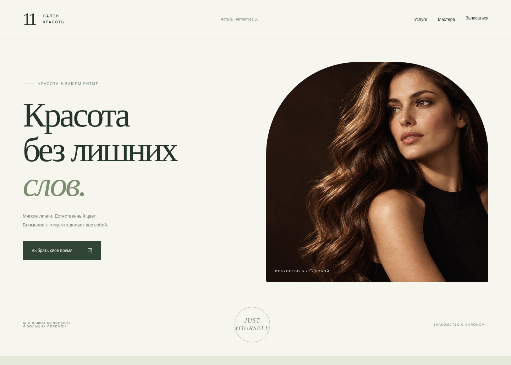
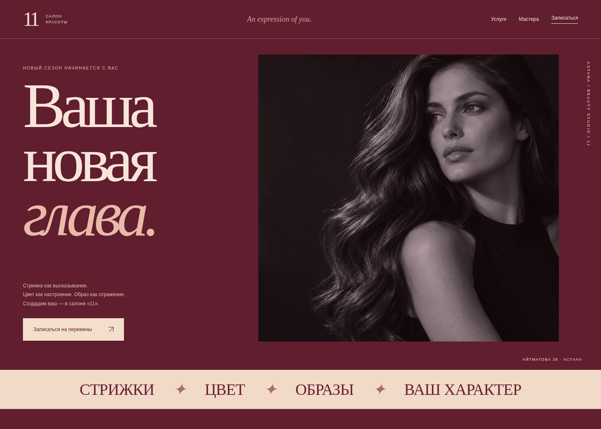
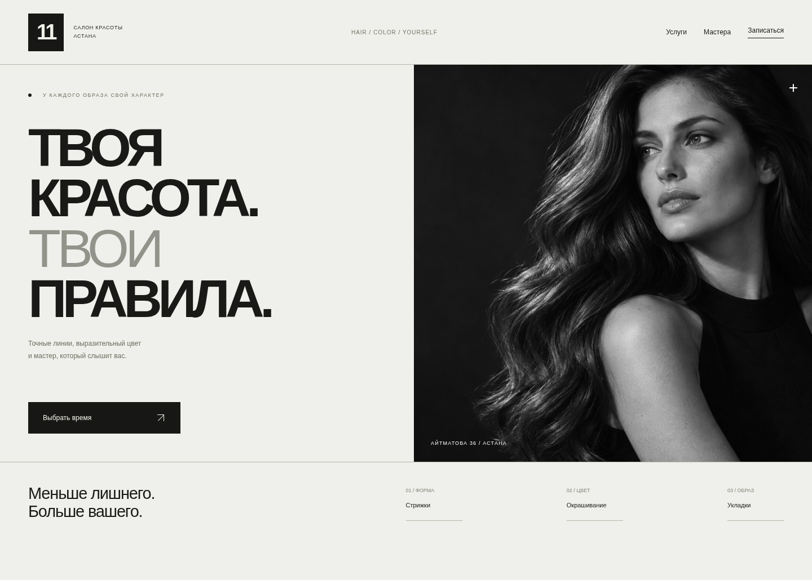

# Ещё три направления дизайна

Визуальные концепции первого экрана для выбора направления. Это отдельные прототипы, а не опубликованные версии сайта. Текущие клиентские страницы и кабинет не изменены. Кнопки записи в прототипах не подключены к базе.

Везде использовано одно иллюстративное изображение, чтобы сравнить композицию, цвет и типографику. Это не фотография работы салона.

## 1. Светлый минимализм

Молочный фон, шалфейный акцент, мягкая арка и антиквенный шрифт. Спокойное впечатление и акцент на естественности.

[На телефоне](docs/concepts/quiet-mobile.png) · [HTML-прототип](docs/concepts/quiet.html)

## 2. Fashion-ателье

Бордовый фон, монохромная фотография, крупная журнальная типографика и контрастная нижняя полоса. Для более выразительного характера бренда.

[На телефоне](docs/concepts/fashion-mobile.png) · [HTML-прототип](docs/concepts/fashion.html)

## 3. Современная графика

Чёрный и белый, строгая сетка, крупный рубленый шрифт. Городской универсальный образ для мужских и женских направлений.

[На телефоне](docs/concepts/modern-mobile.png) · [HTML-прототип](docs/concepts/modern.html)

У всех трёх вариантов проверены загрузка изображения и отсутствие горизонтальной прокрутки на ширине 390px. После выбора направления его можно перенести на услуги, мастеров, запись и кабинет, сохранив текущие функции системы.
