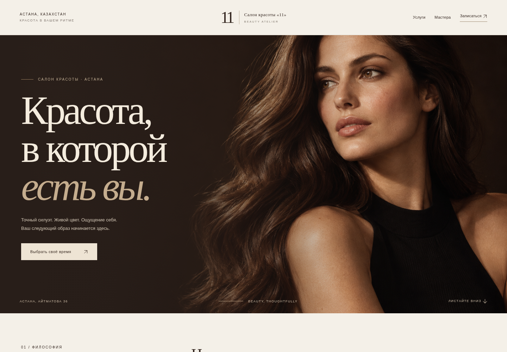
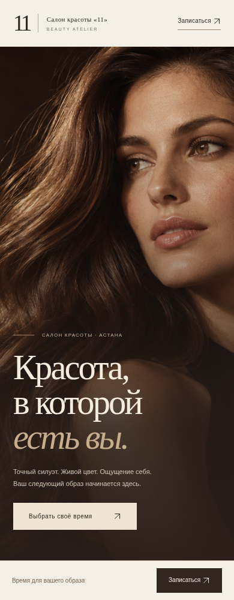
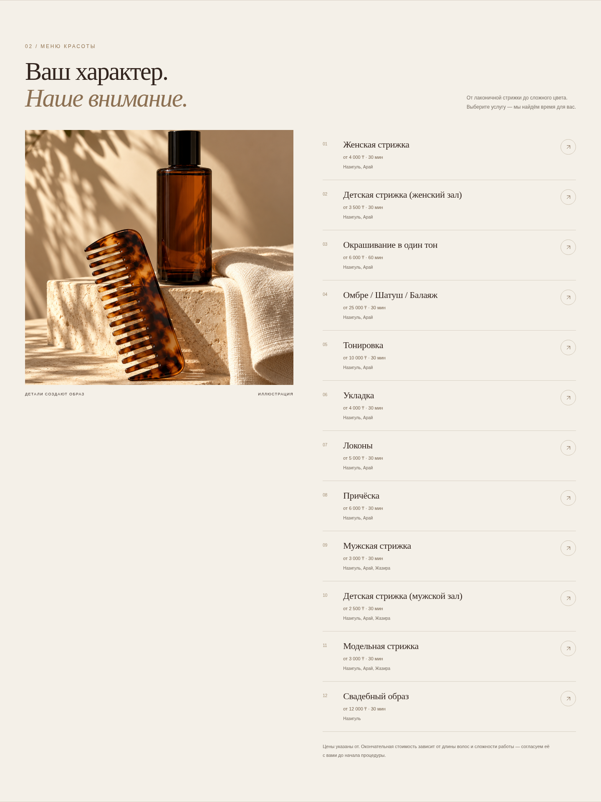

# Салон «11» — новое визуальное направление

Молочный фон, шоколадный цвет, крупная антиквенная типографика, спокойный ритм и журнальная подача услуг. Обновлены текущая клиентская страница и новая серверная версия; кабинет новой версии приведён к той же палитре.

Это локальные превью. Дизайн ещё не опубликован на рабочем адресе.

## Главный экран

## На телефоне

## Меню услуг

## Что изменено

- Логотип, шапка, первый экран, типографика и навигация.
- Иллюстративные изображения для первого экрана и блока услуг; локальные WebP-файлы без внешнего фотохостинга. Преобразование PNG → WebP выполнено без потери пикселей; второе изображение загружается лениво.
- В новой версии — список услуг с ценами, длительностью и мастерами, выбор процедуры одной кнопкой, блок мастеров и переход к записи.
- Форма записи, контактный раздел, подвал и кнопка записи на телефоне.
- Общая палитра кабинета, полей, кнопок и карточек.

Проверены ширины 320, 390, 768 и 1440 пикселей без горизонтальной прокрутки, загрузка изображений и выбор мастера. Прошли браузерные проверки прежней записи и полной новой системы, включая перенос, отмену и оплату. Функции записи и серверные проверки сохранены.

Изображения сгенерированы для оформления и не являются фотографиями работ, мастеров или косметики салона. Для портфолио салона нужны его настоящие снимки. Длительности и цены остаются текущими настройками: дизайн их не меняет.
