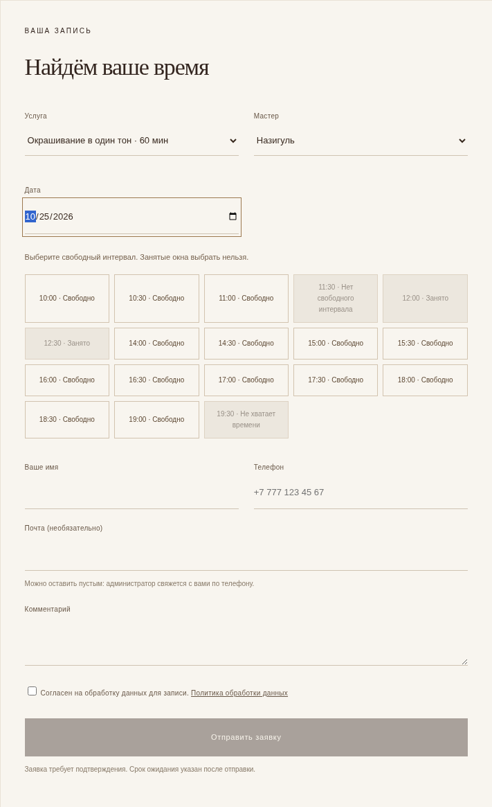
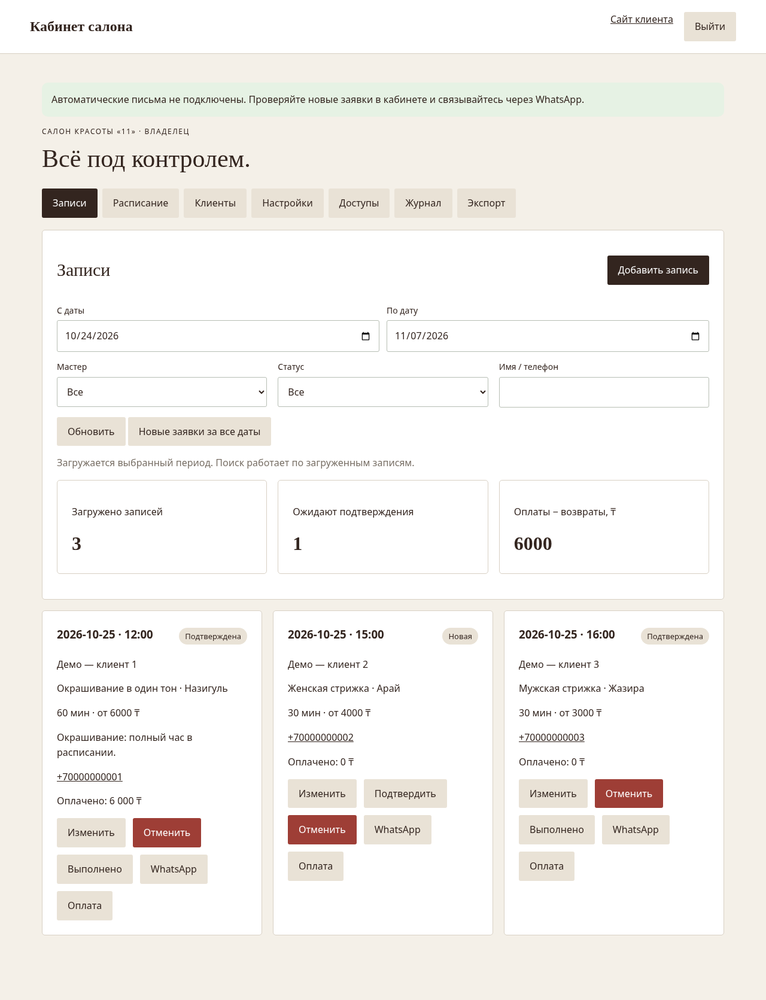
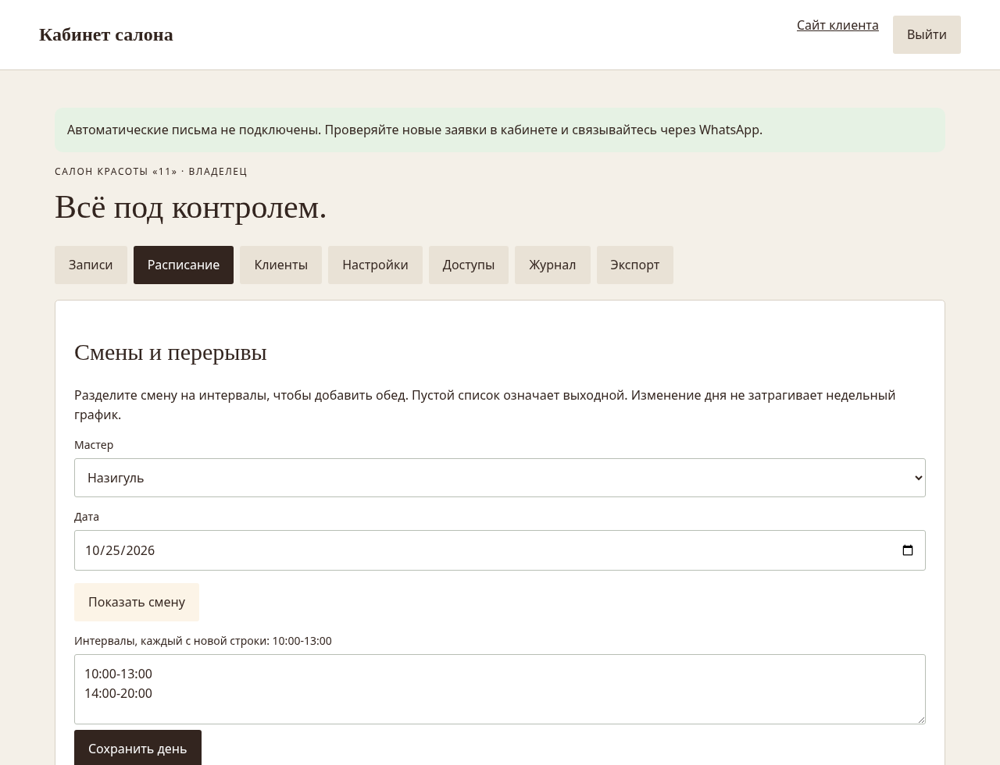
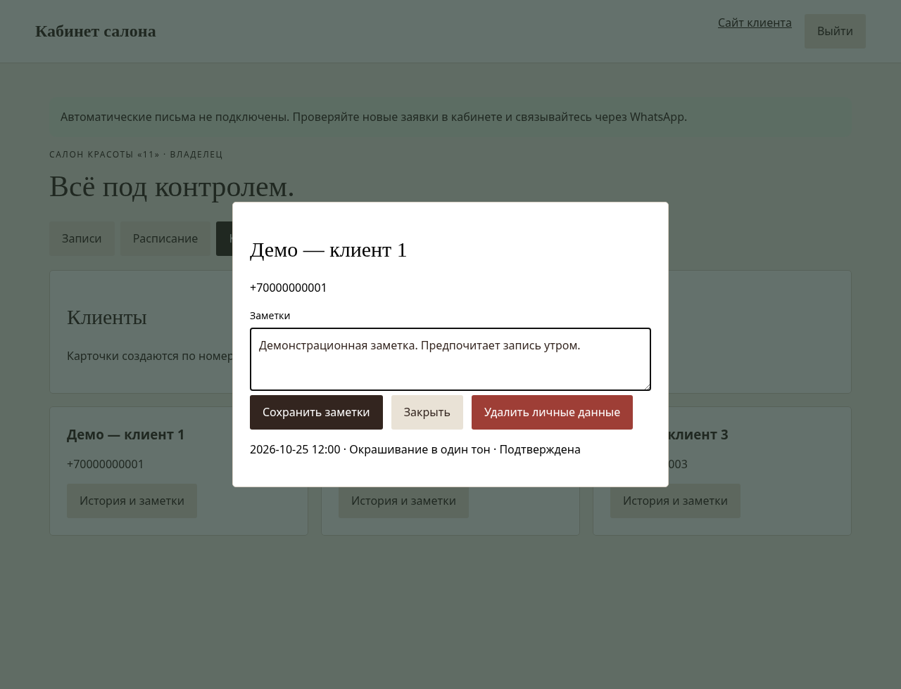
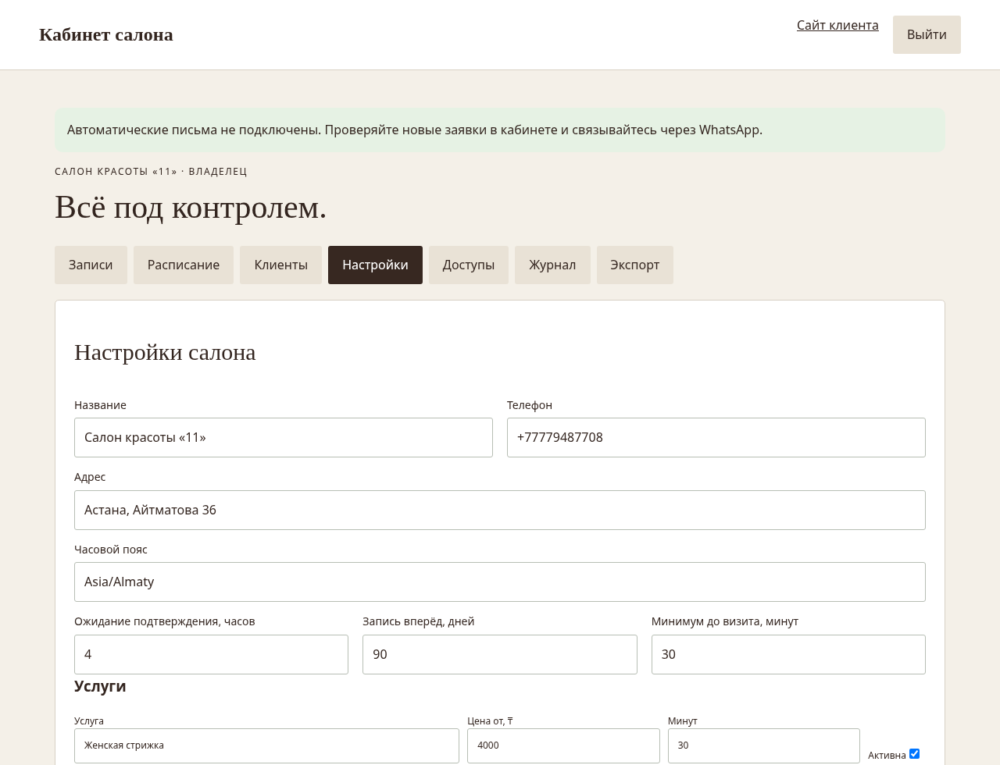
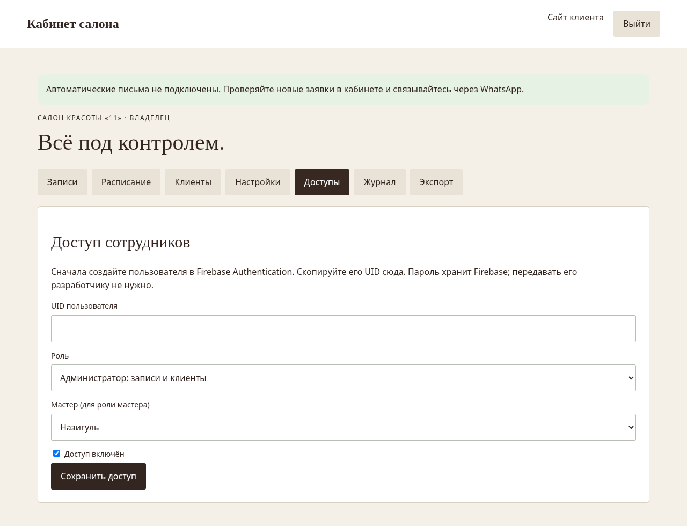

# Новая система салона — обзор экранов

Новый дизайн: [первый экран, мобильная версия и услуги](DESIGN-PREVIEW.md).

Это настоящие скриншоты локально запущенной новой версии. Записи, оплаты, телефоны и заметки клиентов на экранах — демонстрационные. Рабочие данные салона не использовались. На действующем адресе новая версия пока не опубликована.

## Сайт клиента

Услуги, цены, длительности, подходящие мастера, форма записи и контакты.

## Выбор свободного времени

Для окрашивания резервируется весь час. Занятые окна недоступны; учитываются перерыв мастера и время закрытия.

## Записи администратора

Фильтры по датам, мастеру и статусу; поиск по загруженным записям, отдельная очередь новых заявок за все даты, подтверждение, перенос, отмена и отметка выполнения. Оплаты и возвраты — внутренний учёт, не банковский приём платежей и не фискальный чек.

## Смены и перерывы

Мастер и дата, интервалы смены, обед, выходной. Нельзя сохранить смену, оставляющую активную запись за её пределами. Недельный шаблон редактируется в настройках.

## Карточка клиента

История визитов, заметки и удаление личных данных владельцем после завершения/отмены активных записей. Старый архив и резервные копии требуют отдельной обработки.

## Настройки салона

Название, контакты, срок ожидания подтверждения, период записи, услуги, цены, длительности, мастера, недельный график и политика данных. На скриншоте показана верхняя часть раздела.

## Доступы

Пользователи создаются в Firebase Authentication. Владелец назначает роль управляющего, администратора или мастера. Права проверяет сервер; мастер видит свои записи.

## Что работает за этими экранами

- Node.js API; Firestore в опубликованной конфигурации, SQLite для локальной разработки.
- Транзакции для защиты от пересечений, проверки данных и ролей, ограничения массовых заявок, версии записей и защита от повторных операций.
- Срок ожидания неподтверждённой заявки, защищённая ссылка отмены клиентом, журнал действий, экспорт и инструменты восстановления.
- 20 серверных проверок, проверки на эмуляторе Firestore и браузерный сценарий с мобильными экранами и выходом из кабинета.

Для реального запуска остаются серверное подключение Firebase, индексы, проверенный перенос записей и публикация. Автоматическая доставка писем и резервные копии по расписанию не подключены. Подробности: [инструкция](SYSTEM-V2.md), [отчёт проверки](CHECK-2026-10-18.md).
